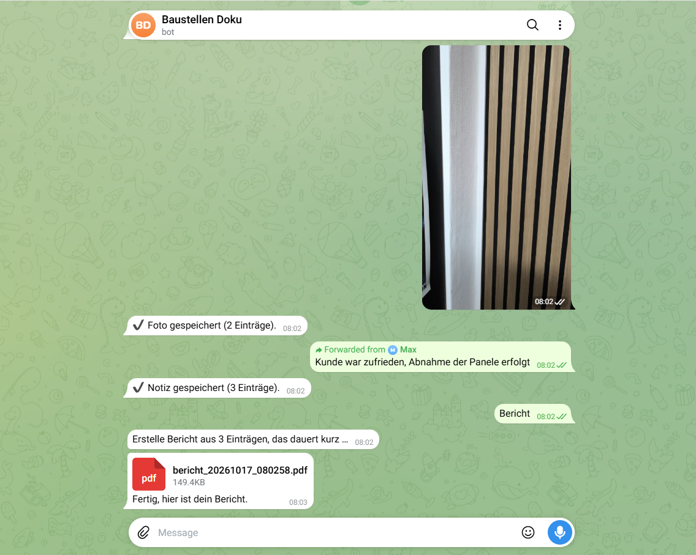
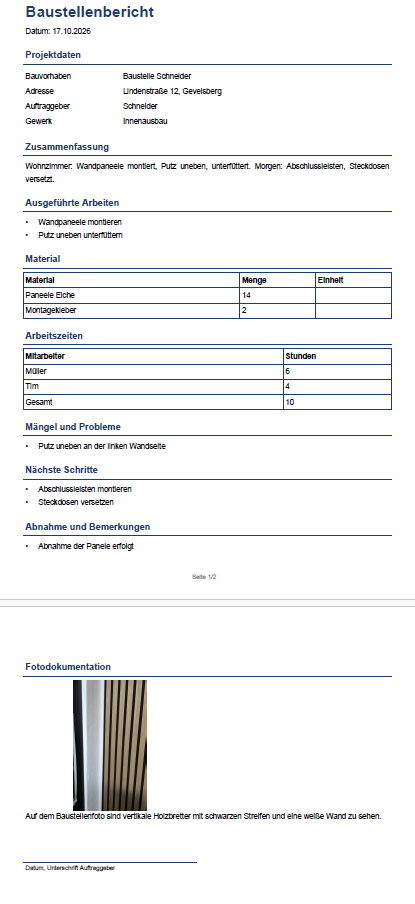
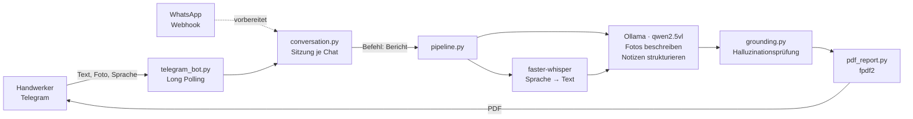

# Site Report Bot – KI-Baustellendokumentation für Handwerker

[](https://github.com/MaxXSammy/site-report-bot/actions/workflows/ci.yml)

Handwerker schicken Fotos, Sprachnachrichten und Notizen per Messenger – der Bot erstellt daraus automatisch einen **strukturierten Baustellenbericht als PDF**. Die KI läuft komplett **lokal und kostenlos**, ohne Cloud-KI.

## Das Problem

Baustellendokumentation passiert oft abends am Schreibtisch: Fotos vom Handy zusammensuchen, Notizen abtippen, Bericht formatieren. Das kostet Zeit, wird aufgeschoben und ist lückenhaft – dabei ist sie wichtig für Abnahmen, Mängelnachweise und Abrechnung.

## Die Lösung

Dokumentiert wird direkt auf der Baustelle, in einem Werkzeug, das jeder schon nutzt: dem Messenger.

1. Fotos, Sprachnachrichten oder Text an den Bot schicken
2. `Bericht` schreiben
3. Das fertige PDF kommt in den Chat zurück

| Telegram-Chat | Erzeugter Bericht |
|---|---|
|  |  |

## Architektur



**Designentscheidungen:**
- **Kanalunabhängiger Kern:** Telegram und WhatsApp übersetzen nur ihr Nachrichtenformat. Gesprächslogik und Pipeline sind identisch – ein neuer Kanal braucht nur einen Adapter.
- **Austauschbares LLM:** `LLMProvider`-Abstraktion; Ollama lokal, später Claude oder Gemini per Konfiguration.
- **Strukturierte Ausgabe:** Pydantic-Schema erzwingt feste Berichtsfelder statt Freitext.
- **Prüfung im Code statt Vertrauen ins LLM:** Namen, Mengen und Stunden, die nicht in den Notizen stehen, werden deterministisch entfernt.
- **Testbar ohne KI:** Dependency Injection in Pipeline und Gesprächslogik – Tests laufen mit Fakes statt echten Modellen.
- **Zugriff nur für Freigeschaltete:** Der Telegram-Bot antwortet nur Chats aus `TELEGRAM_ALLOWED_CHAT_IDS`. Ohne Liste nimmt er von niemandem Nachrichten an. Der WhatsApp-Webhook prüft die Signatur von Meta (`X-Hub-Signature-256`) und lehnt ungeprüfte Aufrufe ab.
- **Datensparsamkeit:** Sprachnachrichten und Baustellenfotos sind personenbezogene Daten. Sie werden gelöscht, sobald der Bericht verschickt oder die Sitzung mit „Neu“ verworfen ist. Das PDF bleibt nur beim Handwerker. Das Protokoll enthält keine Chat-IDs, Telefonnummern oder Nachrichteninhalte, nur ein Pseudonym je Chat.
- **Robuste LLM-Aufrufe:** Timeout, begrenzte Ausgabelänge gegen Endlosschleifen und ein zweiter Versuch bei ungültigem JSON. Scheitert auch der, bleiben die Notizen erhalten und der Handwerker kann es erneut versuchen.

## Tech-Stack

| Bereich | Technologie |
|---|---|
| Sprache | Python 3.12 |
| LLM (Text + Bild) | Ollama mit `qwen2.5vl:7b` (lokal, GPU) |
| Spracherkennung | faster-whisper `medium` (lokal, CPU) |
| Datenmodell | Pydantic |
| PDF | fpdf2 |
| Messenger | Telegram Bot API (httpx), WhatsApp Cloud API (FastAPI) |
| Qualität | pytest, Ruff |

## Erkenntnisse aus der Entwicklung

**Strukturierung mit einem kleinen lokalen Modell**
- Ein JSON-Schema allein reichte nicht – das Modell kopierte alle Notizen in die Zusammenfassung. Erst ein Prompt, der jedes Feld erklärt, verteilt die Informationen korrekt.
- Optionale Felder (`null` erlaubt) wurden fast immer übersprungen. Pflichtfelder lieferten vollständigere Berichte …
- … führten aber zu **Halluzinationen**: Ohne Angaben erfand das Modell Auftraggeber, Mengen und Arbeitsstunden. Ursache war unter anderem ein Beispielname im Prompt, den das Modell wörtlich übernahm.
- **Lösung in zwei Ebenen:** Prompt ohne Beispielwerte („leere Felder sind erwünscht“) **plus** eine deterministische Prüfung (`grounding.py`), die jeden Namen und jede Zahl gegen die Originalnotizen abgleicht.
- **Rollen werden verwechselt:** Der Sprecher („Hier ist Müller“) landete als Auftraggeber im Bericht. Explizite Rollenregeln im Prompt beheben das. Den Auftraggeber leitet der Code zusätzlich aus „Baustelle X“ ab, weil das Modell das Feld sonst oft leer lässt.
- Das Vision-Modell `qwen2.5vl:7b` strukturierte Text mindestens so gut wie das reine Textmodell `qwen2.5:7b` – ein Modell für beide Aufgaben spart VRAM.

**Spracherkennung**
- Whisper `medium` statt `small`: langsamer, aber deutlich genauer bei Fachbegriffen und Zahlen.
- Ein `initial_prompt` mit Fachvokabular und regionalen Ortsnamen verhindert Fehler wie „NYM“ → „endy und m“ oder „Gevelsberg“ → „Gefelsberg“.

## Bekannte Grenzen

- Das 7B-Modell schwankt zwischen Läufen: Einheiten fehlen manchmal, Nebensätze („Kunde war zufrieden“) gehen gelegentlich verloren. Ein größeres Modell lässt sich über `LLMProvider` einbinden.
- Die Halluzinationsprüfung ist eine Heuristik: Sie fängt erfundene Namen und Zahlen ab, aber keine umformulierten Inhalte.
- Ungefähre Angaben („ca. 100 Schrauben“) werden als exakte Zahl übernommen.
- Der Bot verarbeitet Nachrichten nacheinander. Während ein Bericht entsteht, warten andere Chats.
- Sitzungen liegen im Arbeitsspeicher und gehen bei einem Neustart verloren. Mediendateien aus einem früheren Lauf werden beim Start gelöscht.
- Lokal ist die KI, nicht der Transportweg: Fotos und Sprachnachrichten laufen über die Server von Telegram bzw. Meta. Für einen produktiven Einsatz bräuchte es eine Datenschutzprüfung des Kanals oder einen eigenen, selbst gehosteten Messenger.
- Der WhatsApp-Kanal empfängt und prüft Nachrichten, ist aber noch nicht an die Gesprächslogik angebunden (aktiv nach Meta-Unternehmensverifizierung).

## Installation

**Voraussetzungen:** Python 3.12, [Ollama](https://ollama.com), empfohlen eine NVIDIA-GPU (getestet mit 8 GB VRAM).

```bash
git clone https://github.com/MaxXSammy/site-report-bot.git
cd site-report-bot
python -m venv .venv
.venv\Scripts\activate          # Windows  |  source .venv/bin/activate (Linux/macOS)
pip install -r requirements.txt
ollama pull qwen2.5vl:7b
```

`.env.example` nach `.env` kopieren und den Telegram-Token von [@BotFather](https://t.me/BotFather) eintragen. Dann den Bot starten und ihm eine Nachricht schicken: Er antwortet mit der eigenen Chat-ID. Diese in `TELEGRAM_ALLOWED_CHAT_IDS` eintragen und den Bot neu starten.

## Nutzung

```bash
python -m site_report_bot
```

Im Chat mit dem Bot:

| Eingabe | Wirkung |
|---|---|
| Foto, Sprachnachricht, Text | wird gesammelt (Bildunterschriften werden zu Notizen) |
| `Bericht` | erstellt das PDF und schickt es zurück |
| `Neu` | verwirft alle gesammelten Notizen |
| `Hilfe` | zeigt die Anleitung |

## Tests

```bash
pytest
```

40 Tests decken Datenmodell, PDF-Erzeugung, Pipeline, Halluzinationsprüfung, Gesprächslogik und das Parsen von Telegram- und WhatsApp-Nachrichten ab, dazu Zugriffsschutz, Webhook-Signatur, das Löschen von Mediendateien, Protokolle ohne personenbezogene Daten und ungültige LLM-Ausgaben.

## Projektstruktur

```
site_report_bot/
├── config.py            # Einstellungen aus .env
├── models.py            # Pydantic-Datenmodell des Berichts
├── llm.py               # LLM-Abstraktion und Prompt (Ollama)
├── grounding.py         # Halluzinationsprüfung gegen die Originalnotizen
├── transcription.py     # Sprache → Text (faster-whisper)
├── pdf_report.py        # PDF-Erzeugung
├── pipeline.py          # Eingaben → Bericht → PDF
├── conversation.py      # Gesprächslogik, kanalunabhängig
├── telegram_client.py   # Telegram Bot API
├── telegram_bot.py      # Telegram-Kanal (Long Polling)
└── whatsapp.py          # WhatsApp-Kanal (Webhook)
tests/                   # pytest
scripts/                 # Demo-Skripte für Einzelkomponenten
docs/                    # Screenshots
```

## Roadmap

- [x] **Stufe 1 – MVP:** Messenger-Eingang → LLM-Strukturierung → PDF-Bericht
- [ ] **Stufe 2:** Digitale Kundenunterschrift mit Feedback-Schleife
- [ ] **Stufe 3:** Prüfung durch Menschen (Human in the Loop) und Rechnungsentwurf
- [ ] **Stufe 4:** Mehrere Kanäle – WhatsApp-Anbindung ist vorbereitet, aktiv nach Meta-Unternehmensverifizierung

## Lizenz

Siehe [LICENSE](LICENSE).
